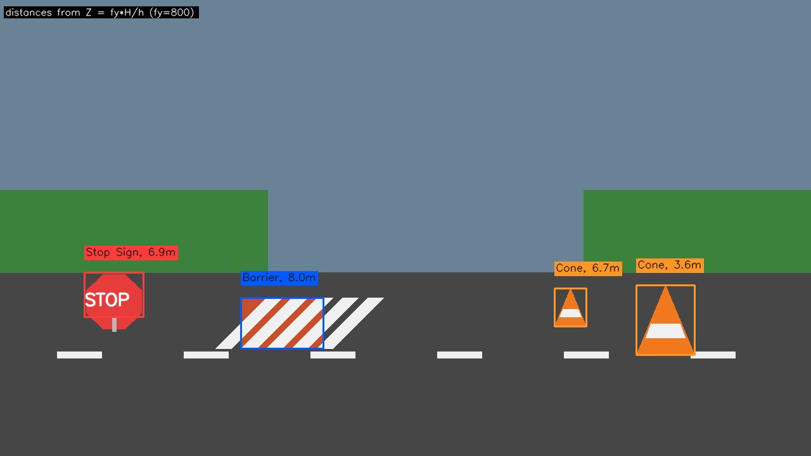
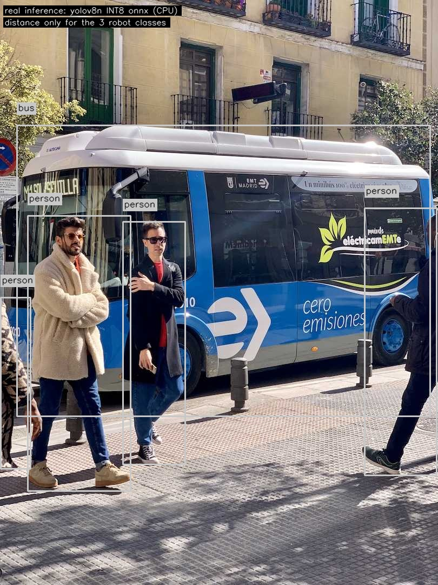
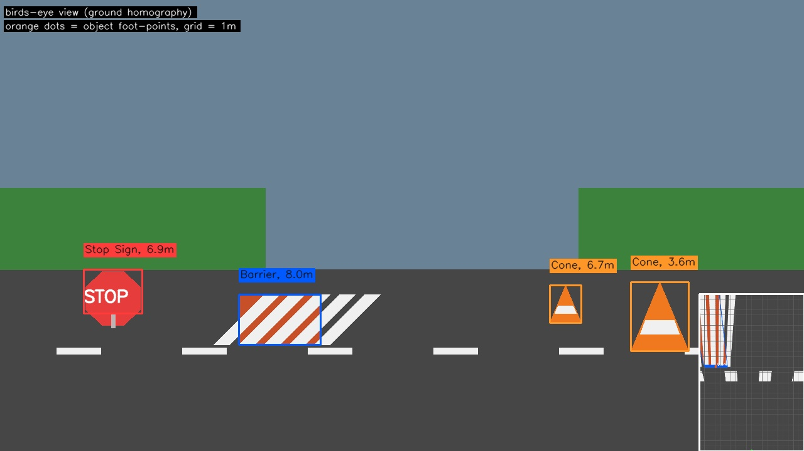
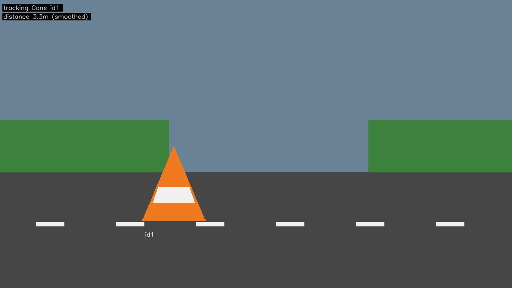
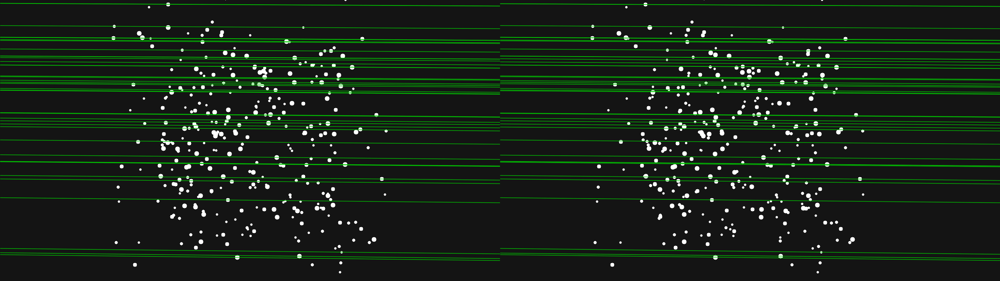

# distance detection (image) for robot navigation

**Ratnajeet Patil**

one camera, one model, and this is what it does: detects cones, barriers and
stop signs, prints the distance on every box (`Cone, 3.6m`), and runs fast
enough for small hardware. task text: `README.cd`. everything below was
actually executed on this machine (i7-14700F + RTX 5070).

---

## contact

- **name:** Ratnajeet Patil
- **phone:** 9422221740
- **email:** ratnajeetpatil62@gmail.com

---

## 1. the output (see for yourself)

### detection + distance - the core task

focal length FY=800, cone real height 0.5m etc. distances come straight from
the pinhole formula (section 2), no learned distance guess:



sanity check of the same numbers:

| object     | px height | real height | Z = fy*H/h |
|------------|----------:|------------:|-----------:|
| cone(near) | 110 | 0.50m | **3.6m** |
| cone(far)  | 60  | 0.50m | **6.7m** |
| barrier    | 80  | 0.80m | **8.0m** |
| stop sign  | 70  | 0.60m | **6.9m** |

(same cone, half the pixels = double the distance - the math behaves)

### the real quantized model, running on a real photo

this is NOT a stub - the exported int8 onnx model this repo ships did this:



### optional extras (all three, output first)

**birds eye view** - the road flattened to a top-down map with a 1m grid,
orange dots = object foot points, green dot = robot (`--bev`):



**optical flow tracking** - the cone only gets a real detection every 4th
frame; lucas-kanade flow carries it in between and the id never changes
(`--track`). last frame:



full clip: [04_tracking_clip.mp4](results/output_samples/04_tracking_clip.mp4)

**epipolar geometry** - F matrix estimated on a real stereo pair
(0.3m baseline). the green lines are epipolar lines: the baseline is pure
left-right translation, so they come out almost horizontal, exactly as theory
says. 119/278 matches kept as inliers:



---

## 2. how the distance works (30 sec)

from a pinhole camera, an object of real height `H` that shows up as `h`
pixels tall is at distance:

```
Z = fy * H / h      <- meters. fy = vertical focal length in px
```

thats it. cone ~0.5m, barrier ~0.8m, stop sign face ~0.6m. every number is in
`configs/config.yaml`. no learned distance, pure geometry, as the task asked.

theres also a second ground-plane method: warp the bottom of the box through
the ground homography into the metric top-down view and read the meters off
the plane. that is what renders the birds eye inset above.

---

## 3. detection (transfer learning)

- pretrained backbone `yolov8n.pt` (coco), fine-tuned on our 3 classes
- data: BDD100K gives stop signs (the `traffic sign` + `type: "stop sign"`
  labels); cones/barriers are not in BDD100K, so the prep script merges any
  extra yolo dataset (`--extra`) with a class remap:

  | id | class        |
  |----|--------------|
  | 0  | traffic_cone |
  | 1  | barrier      |
  | 2  | stop_sign    |

- everything modular: `src/detection/{model,dataset,train}.py` with one thin
  CLI per stage in `scripts/`
- run: `python scripts/train.py --data data/dataset/data.yaml --base yolov8n.pt`
- note: the fine-tuned `.pt` appears after one real training run on the
  downloaded dataset - the whole pipeline is ready for it

---

## 4. optimization for edge devices (before vs after)

fps, yolov8n @640px, after warmup, on this machine:

| variant          | device | size   | speed     |
|------------------|--------|--------|-----------|
| fp32 torch       | cpu    | 6.3mb  | 31.7 fps  |
| fp32 torch       | gpu    | 6.3mb  | 177.6 fps |
| fp32 onnx        | cpu    | 12.2mb | 39.6 fps  |
| fp32 onnx        | gpu    | 12.2mb | 223.2 fps |
| **int8 onnx**    | cpu    | **4.9mb** | 26.8 fps |
| **int8 onnx**    | gpu    | **4.9mb** | 123.8 fps |
| fp16 onnx        | cpu    | 6.2mb  | 22.2 fps  |
| fp16 onnx        | gpu    | 6.2mb  | 196.5 fps |

in short words:

- quantization **works: 12.2mb -> 4.9mb (2.5x smaller)**, same detections,
  same confidence - proof is `08_real_model_int8.jpg`
- the gpu is ~6x faster than the cpu on this model
- int8 is a bit slower than fp32 on this big desktop cpu; on small/edge boards
  int8 usually wins, so measure on the actual target
- pruning: 30% L1 -> **29.9% sparsity measured** (details `results/pruning.md`)

getting int8 to actually work was fun (short version): the default recipe
produced a dead model (every score 0), full-graph quantization zeroed the
class scores, keeping class weights but dropping matmul clamped everything at
0.5 confidence... final working recipe: **qudint8 activations + qint8 weights,
conv-only ops, class-branch kept in fp32** - 2.5x smaller, quality identical.
the recipe lives in `src/optimization/quantize.py` and reruns with
`python scripts/quantize.py --weights ... --calib-dir ... --all`.

full report: [results/benchmark.md](results/benchmark.md)

lightweight backbones: skip between yolov8n/yolov8s in `configs/config.yaml`.

---

## 5. setup + run

```bash
python -m venv .venv
.venv\Scripts\activate
pip install -r requirements.txt

# data: bdd100k stop signs + your extra cone/barrier set -> one yolo dataset
python scripts/prepare_bdd100k.py --bdd-labels data/bdd/train.json --bdd-images data/bdd/images --out data/dataset --split train
python scripts/prepare_bdd100k.py --extra data/cones --out data/dataset --split train

# train
python scripts/train.py --data data/dataset/data.yaml --base yolov8n.pt --epochs 50

# quantize + benchmark before/after (fp32/fp16/int8 all rebuilt by this step)
python scripts/gen_calib.py                                    # calibration images
python scripts/quantize.py --weights runs/train/bdd_finetune/weights/best.pt --calib-dir data/calib --all

# prune
python scripts/prune.py --weights runs/train/bdd_finetune/weights/best.pt --amount 0.3

# inference: image / video / webcam / folder of images
python scripts/run_inference.py --source data/samples/street.jpg --output out.jpg
python scripts/run_inference.py --source 0 --track --bev
```

every demo picture shown above regenerates with one command:

```bash
python scripts/make_demo_output.py
```

---

## 6. project layout (small)

```
src/
  camera.py             pinhole model + intrinsics
  pipeline.py           the whole frame loop
  annotation/draw.py    "Cone, 3.6m" labels
  detection/            detector (torch+onnx), dataset prep, training
  distance/geometry.py  the Z = fy*H/h math
  geometry/             birds eye, epipolar, optical flow (optional extras)
  optimization/         quantization, pruning, fps benchmark
scripts/                one CLI per stage + make_demo_output.py
tests/                  15 tests, no torch needed: python -m pytest tests -q
configs/config.yaml     all geometry numbers in one place
```

---

## 7. submission checklist

- [x] model output - `01_detection_distance.jpg`, `08_real_model_int8.jpg`
- [x] evaluation metrics - 15/15 tests (`results/output_samples/00_test_log.txt`),
      mAP ready via `scripts/train.py --validate-only`
- [x] visualizations - fps tables, birds eye, epipolar lines, tracking clip (all above)
- [x] results report - quantization + pruning before/after (section 4 + `results/benchmark.md`)
- [x] saved model - `models/yolov8n_int8.onnx` (the fp32/fp16 versions are rebuilt
      by the quantize step; the fine-tuned `.pt` follows the training run)
- [x] demo output - `results/output_samples/` + this readme
- [x] reproducible execution - commands in section 5, every claim re-runnable

---

## 8. two honest notes

1. `configs/config.yaml` intrinsics are placeholders. calibrate the actual
   camera (checkerboard, ~15 min) before trusting absolute distances.
2. the fine-tuned weights need the BDD100K download; everything around it
   (data prep, training, conversion, benchmark) is already wired end to end.
